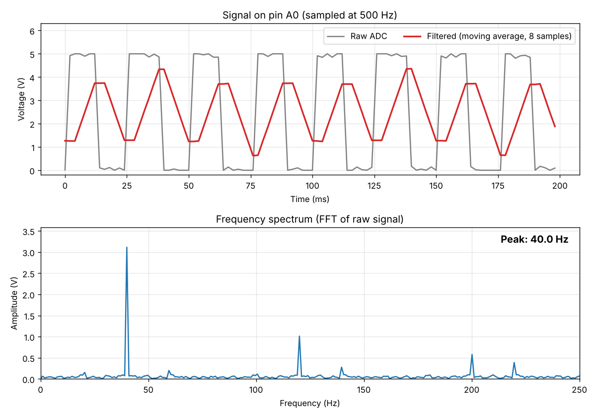

# Real-Time Signal Analyzer on Arduino

An Arduino Uno samples an analog signal at **500 Hz** using a **timer interrupt**, filters it, and sends it over **UART** to a laptop. A Python script plots the signal and its **FFT** (frequency spectrum) live.

Timer, ADC and UART are configured by writing to the chip's **registers directly with bit manipulation**. The code doesn't use `analogRead()` or the `Serial` library.



*The 40 Hz test signal: the raw signal (gray), the filtered signal (red), and the FFT with its peak at 40 Hz.*

---

## How it works

```
 Timer1 (500 Hz) ──interrupt──> ISR: read ADC, start next conversion, push to buffer
                                              │
                                     Circular buffer (64 samples)
                                              │
 Main loop: pop sample ──> moving-average filter ──> UART "raw,filtered\n" ──> USB
                                                                                │
                                                     Python: live plot + FFT <──┘
```

| Part | What it does | File |
|---|---|---|
| Timer1 | Fires an interrupt exactly 500 times per second | `signal_analyzer.ino` |
| ADC | Converts the voltage on pin A0 into a number from 0 to 1023 | `signal_analyzer.ino` |
| ISR | Saves one sample and exits (kept very short) | `signal_analyzer.ino` |
| Circular buffer | Passes samples safely from the ISR to the main loop | `signal_utils.h` |
| Moving average | Smooths the signal (average of the last 8 samples) | `signal_utils.h` |
| UART | Sends the numbers to the laptop at 115200 baud | `signal_analyzer.ino` |
| Python plotter | Shows the signal and FFT, and marks the peak frequency | `python/live_plot.py` |

---

## Project structure

```
arduino-signal-analyzer/
├── firmware/signal_analyzer/
│   ├── signal_analyzer.ino   # main firmware: registers, ISR, UART
│   └── signal_utils.h        # circular buffer + moving-average filter
├── python/
│   └── live_plot.py          # live plot + FFT (also has a --demo mode)
├── test/
│   └── test_signal_utils.c   # tests buffer + filter on a laptop
├── plots/
│   └── demo_result.png
└── requirements.txt
```

---

## What you need

- Arduino Uno and its USB cable
- 1 jumper wire (male-to-male)
- Arduino IDE, Python 3

## Wiring

Connect **pin 8 → pin A0** with the jumper wire.

Pin 8 outputs a 40 Hz square wave (the test signal) and A0 is the ADC input, so the Arduino measures its own test signal.

```
   Arduino Uno
  ┌───────────┐
  │   pin 8 ●─┼──────┐
  │           │      │  jumper wire
  │   pin A0 ●┼──────┘
  └───────────┘
```

---

## How to run

### 1. Upload the firmware
1. Open `firmware/signal_analyzer/signal_analyzer.ino` in the Arduino IDE.
2. Go to **Tools → Board → Arduino Uno** and **Tools → Port →** your port (for example COM3).
3. Click **Upload**.
4. **Do not open the Serial Monitor.** Only one program can use the port at a time.

### 2. Run the live plot
```bash
pip install -r requirements.txt
python python/live_plot.py --port COM3
```
Use your own port. On Linux it is usually `/dev/ttyACM0`. The FFT should show **Peak: 40.0 Hz**.

### No Arduino yet? Use demo mode
```bash
python python/live_plot.py --demo
```
This simulates the same 40 Hz signal and the same filter, so you can see how it works without the hardware.

### Test the buffer and filter on your laptop
```bash
gcc -Wall test/test_signal_utils.c -o test_utils
./test_utils          # Windows: test_utils.exe
```
Expected: `ALL TESTS PASSED` (7 tests).

---

## Key concepts (simple explanation)

### Registers and bit manipulation
A register is a small memory location inside the chip that controls hardware. Each bit turns a feature on or off.
```c
TCCR1B |= (1 << WGM12);   // SET bit WGM12   -> timer in CTC mode
ADCSRA |= (1 << ADSC);    // SET bit ADSC    -> start an ADC conversion
while (!(UCSR0A & (1 << UDRE0)));   // CHECK bit UDRE0 -> wait until UART is ready
```
- `x |= (1 << n)` sets bit n to 1.
- `x & (1 << n)` checks whether bit n is 1.

### Timer interrupt (why 499?)
- The CPU clock is 16 MHz. With a prescaler of 64, the timer counts 250,000 times per second.
- The timer counts from 0 to `OCR1A`, then fires an interrupt and starts again.
- For 500 Hz: `OCR1A = 250000 / 500 - 1 = 499`.

### ADC
- The ADC turns 0–5 V into a number from 0 to 1023 (10 bits).
- Voltage = `value × 5 / 1023`.
- One conversion takes about 104 µs, much less than the 2 ms between samples.

### Why the ISR is short
The ISR runs 500 times per second. If it took a long time, the next interrupt would be late and the sampling rate would become uneven. So the ISR only saves the sample and exits. Filtering and sending are done in the main loop.

### Circular buffer
An array used like a ring. The ISR writes at `head` and the main loop reads at `tail`. When an index reaches the end, it wraps back to 0. Since the size is 64 (a power of 2), wrapping uses a bit mask, `(i + 1) & 63`, which is faster than `% 64`.

### Moving-average filter
Each output is the average of the last 8 samples. The code keeps a running sum, so each step costs only one subtraction and one addition. Dividing by 8 is done as `sum >> 3` (shift right by 3), which is faster than division on a small chip.

### FFT
The FFT shows which frequencies are in a signal. A 40 Hz square wave gives:
- the main peak at **40 Hz**
- smaller peaks at **120 Hz and 200 Hz** (odd harmonics: 3×40 and 5×40, which a square wave always has)

### Aliasing (why there is a small peak at 220 Hz)
With a 500 Hz sampling rate, the highest frequency we can measure is **250 Hz** (Nyquist = sampling rate / 2). The 7th harmonic, at 280 Hz, is above that, so it "folds back" and appears at 500 − 280 = **220 Hz**. This effect is called **aliasing**.

---

## What I learned
- Register-level programming of Timer, ADC and UART with bit manipulation
- Interrupts and ISRs, and why ISRs must be short
- Circular buffers for passing data between an ISR and the main loop
- Fixed-rate sampling, the Nyquist limit and aliasing
- Digital filtering on a microcontroller using integer maths and bit shifts
- Plotting signals and their FFT in Python
